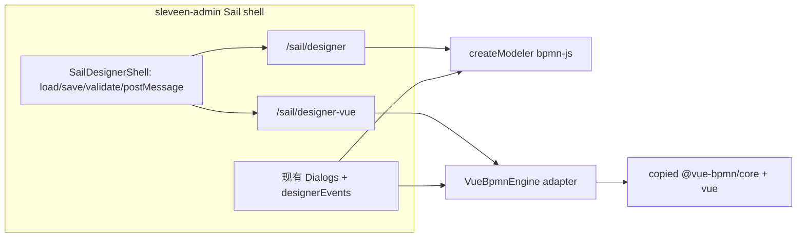

# 引入自研 Vue BPMN 设计器（并行第 2 实现）

## 决策锁定

- **切换**：独立路由 [`/sail/designer-vue`](C:\sleveen\code\gitee\sleveen-admin\web\src\router\routes\builtin.ts)（现有 `/sail/designer` 不变）
- **首期范围**：对齐现有 Sail 能力（画布 + sf 扩展不丢 + 节点/连线/办理人等配置对话框可用），非仅画布验证
- **引入方式**：源码复制（非 npm 发布、非 iframe 包）
- **宿主**：[`sleveen-admin/web/src/widgets/sailflow`](C:\sleveen\code\gitee\sleveen-admin\web\src\widgets\sailflow)；引擎仓 sailflow 不改 UI

## 1. 源码落位与工程接线

从 [`c:\sleveen\code\gitee\bpmnjs`](c:\sleveen\code\gitee\bpmnjs) 复制：

- `packages/core/src` → [`web/src/widgets/sailflow/vue-bpmn/core`](C:\sleveen\code\gitee\sleveen-admin\web\src\widgets\sailflow)
- `packages/vue-bpmn/src` → `web/src/widgets/sailflow/vue-bpmn/vue`

在 [`web/vite.config.ts`](C:\sleveen\code\gitee\sleveen-admin\web\vite.config.ts) 增加别名（对齐 playground）：

- `@vue-bpmn/core` → `.../vue-bpmn/core/index.ts`
- `@vue-bpmn/vue` → `.../vue-bpmn/vue/index.ts`

依赖：在 [`web/package.json`](C:\sleveen\code\gitee\sleveen-admin\web\package.json) 增加 `@xmldom/xmldom`（与源仓一致）。**不**把 bpmnjs 的 verification/playground 拷进产品。

在 `vue-bpmn/README.md`（短注）标明：源出 `bpmnjs` 某 commit、禁止产品依赖 bpmn-js、后续以拷贝或脚本同步更新。

## 2. 设计器适配层（双实现共用壳）

新增薄接口（建议路径 `@sail/designer/engine.ts`），统一宿主调用面：

- `importXML` / `exportXML` / `exportSVG`
- `undo` / `redo` / zoom / align（工具栏所需）
- 选择变更、commandStack 变更订阅
- `getModelingBridge()`：向现有对话框提供 `updateProperties` + 写 sf 扩展的能力

两套实现：

- **BpmnJsEngine**：包装现有 [`createModeler.ts`](C:\sleveen\code\gitee\sleveen-admin\web\src\widgets\sailflow\bpmn\createModeler.ts)（短期可只给旧页用，或逐步改旧页走接口）
- **VueBpmnEngine**：包装 `<BpmnModeler>` ref API（`importXML`/`exportXML`/`getStore` 等）

抽出共用壳 **SailDesignerShell**（从 [`SailDesignerPage.vue`](C:\sleveen\code\gitee\sleveen-admin\web\src\widgets\sailflow\views\SailDesignerPage.vue) 拆出）：`queryProcessFile` / `saveProcessFile` / `validateProcess` / embed `postMessage` / 顶部操作条与对话框挂载。旧页继续默认 bpmn-js；新页挂 Vue 引擎。

工具栏：[`SailDesignerToolbar.vue`](C:\sleveen\code\gitee\sleveen-admin\web\src\widgets\sailflow\components\designer\SailDesignerToolbar.vue) 改为依赖 `ProcessDesignerEngine`，去掉对 `modeler.get('eventBus')` 的硬绑（模拟按钮在 vue 引擎上短期禁用或隐藏）。

## 3. 阻塞项：BPMN XML 对 `sf:` 不丢

当前 vue-bpmn [`importXml`/`exportXml`](c:\sleveen\code\gitee\bpmnjs\packages\core\src\xml\exportXml.ts) **不保留** `sf:` 属性与 `extensionElements`。首期 2B 前必须先做：

- 在 `DiagramElement.businessObject`（或并列字段）中 **opaque 保留** 未知属性与子 XML 片段
- `exportXml` 原样写回；新增/未配置节点写出空扩展骨架时与引擎约定一致（对照 [`buildSfModdle`](C:\sleveen\code\gitee\sleveen-admin\web\src\widgets\sailflow\bpmn\buildSfModdle.ts) / 现有保存结果）
- 单测/夹具：用现有 Sail 流程 XML 做 round-trip，assert 关键 `sf:` 扩展块

此项改在**拷贝进 sleveen-admin 的源码**上完成（可回馈 bpmnjs 仓，但不阻塞宿主并行）。

## 4. Sail 配置能力接到 Vue 引擎（首期对齐）

现有能力经 [`designerEvents`](C:\sleveen\code\gitee\sleveen-admin\web\src\widgets\sailflow\bpmn\ui\designerEvents.ts) + Dialogs 驱动，payload 依赖 bpmn-js 的 `element` / `modeling` / `moddle`。

做法（选定）：

1. **ModelingBridge（Vue）**：基于 `DiagramStore` + `createSetPropertyCommand` / 扩展 XML 读写，实现与 Dialogs 约定的 `updateProperties`、以及 `sfExtension` 读写等价物（新建 `@sail/bpmn/utils/sfExtensionVue.ts`，不依赖 `bpmn-js/lib/util/ModelUtil`）。
2. **事件桥**：在 Vue 属性面板旁挂「完整配置」入口（对标 [`installNodeConfigHeaderGear`](C:\sleveen\code\gitee\sleveen-admin\web\src\widgets\sailflow\bpmn\ui\installNodeConfigHeaderGear.ts)），`emit` 现有 `nodeconfig:open` / `transitionconfig:open` / `assignee-params:open` 等；**尽量复用**现有 `SailNodeConfigDialog`、`SailTransitionConfigDialog`、`SailAssigneeParamsDialog`、各类 Picker，只替换底层 element/modeling 适配。
3. **侧栏属性**：首期不重写全部 Sf* PropertiesProvider；策略是 **通用 BPMN 属性用 vue 自带面板 + Sail 关键配置走已有大弹窗**（与现网「齿轮打开完整配置」路径一致）。若某字段仅存在于旧侧栏，在 Vue 页用弹窗入口补齐，避免一次性移植全部 Provider。
4. **设计默认值**：[`assigneeDefaults`](C:\sleveen\code\gitee\sleveen-admin\web\src\widgets\sailflow\bpmn\assigneeDefaults.ts) / [`eventNameDefaults`](C:\sleveen\code\gitee\sleveen-admin\web\src\widgets\sailflow\bpmn\eventNameDefaults.ts) 改为监听 Vue store 的 create/replace，写入同等 `sf:` 默认。

## 5. 路由与入口

- 在 [`builtin.ts`](C:\sleveen\code\gitee\sleveen-admin\web\src\router\routes\builtin.ts) 增加 `sail-designer-vue` → `/sail/designer-vue` → 新页（blank-layout），query 仍支持 `processId` / `version` / `embed=1`。
- [`ProcessDesign.vue`](C:\sleveen\code\gitee\sleveen-admin\web\src\widgets\sailflow\views\model\form\ProcessDesign.vue)：保留默认 iframe → `/sail/designer`；增加「用 Vue 设计器打开」按钮（新窗口或第二 iframe 源切到 `/sail/designer-vue`），`postMessage` 协议不变。
- 流程列表/模板页：增加并列入口打开 `/sail/designer-vue`（不改默认主入口）。

## 6. 验收与后续移除 bpmn-js

**并行期验收清单**

- 新建流程：画布建模 → 保存 → 引擎校验通过
- 打开已有含 `sf:` 的流程：编辑拓扑后保存，扩展配置不丢
- UserTask：办理人 Resolve/Leave、表单、按钮等经对话框可读写并落库
- SequenceFlow：条件/转移配置可读写
- embed：向导保存触发 `sail-designer-save` 仍可用
- 产品包依赖扫描：Vue 设计器路径无新增 bpmn-js import（旧路径可保留）

**移除 bpmn-js（本期不做，仅门槛）**：Vue 路径稳定、入口全部切默认、删 `createModeler`/Sf Providers/npm bpmn-* 依赖与 vite `ids` shim。

## 关键文件

| 动作 | 路径 |
|------|------|
| 新增拷贝 | `web/src/widgets/sailflow/vue-bpmn/{core,vue}/` |
| 新增 | `@sail/designer/engine.ts`、`VueBpmnEngine`、`SailDesignerVuePage.vue`、可选 `SailDesignerShell` |
| 改 | `vite.config.ts`、`package.json`、`builtin.ts`、`ProcessDesign.vue`、`SailDesignerToolbar.vue`、sf 扩展工具与 defaults |
| 后置改（拷贝源） | `vue-bpmn/core` 的 XML import/export opaque 扩展 |
