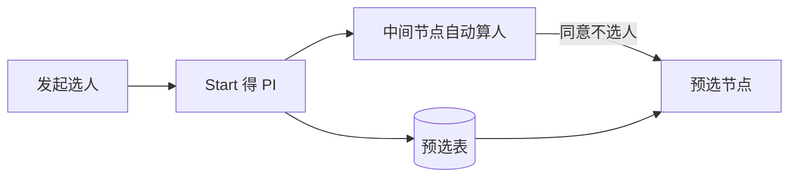

# 指南：待办人预选场景（发起时指定后续节点办理人）

> 状态：**实施指南**（2026-11-15；**骨架 + sleveen 表已落地一版**）— 对照现行 Assignee 插件能力与分层约定；`Preselect` 默认不进 RegisterBuiltins，宿主 `UseSleveenPreselectAssignees` 显式启用。  

> 关联：[特性说明-待办人管道.md](../sail/特性说明-待办人管道.md)（R1–R10 / F3）· [架构设计-项目依赖与分层.md](../sail/架构设计-项目依赖与分层.md)（§2.5 流程侧留骨架）· [最佳实践-宿主能力包UseXxx.md](../sail/最佳实践-宿主能力包UseXxx.md) · 宿主讨论稿 `sleveen-admin/doc/sailflow-assignee-candidate-design.md`（定范围 #8）  
> 审计快照：[审计-sailflow相对常见OA引擎流程能力对照](../audit/审计-sailflow相对常见OA引擎流程能力对照-2026-11-14.md)（「发起人自选 ✅」= 管道能力；「未来节点换人 ❌」= 无独立改人 API，本场景用预选表覆盖）

---

## 0. 场景与目标

**业务口述：** 发起人对后续若干环节审批人已清楚（如「施工影响单位审批」）。发起时选好人；中间节点（如部门领导）通过时**不必再选人**，直接发送，待办落到预选人。

| 目标 | 非目标 |
|------|--------|
| 按**流程实例 + 节点**持久化预选办理人 | 不改 Mediator / 流转内核 |
| 到达该节点时时刻 A Resolve 从表取人 | 不做抄送/通知（R5） |
| 中间节点可「同意即发」、无强制选人框 | 不把预选做成 Leave / EmptyAction Type |
| 骨架可复用，业务具化 Store 并注册 | 不锁死宿主 `SysUser` / 组织表 schema |

产品叙事对应待办人管道 **定范围 #8「发起人自选」**（多环节、发起页选人、后续领导不再选）。内置 `StarterPick` **只读当次** `NextActivityPerformers`，**无**实例级持久化——本指南用 **预选表 + Resolve 插件**补齐。

---

## 1. 现行能力边界（为何不靠库存按钮）

| 层级 | 现状 | 含义 |
|------|------|------|
| 引擎算人 | `StarterPick` / `ApproverPick` / `Expression` / `BusinessCallback` / 可注册 `IAssigneeResolver` | 时刻 A 可按已有数据派人 |
| `NextActivityPerformers` | 仅服务**当次** Start/Run 载荷 | 发起时多 key **不会**自动带到后续 `RunProcess` |
| `ActivityInstance.NextStepPerformers` | 网关/事件/加签等路径序列化 | **不是**通用「未来节点办理人仓」 |
| Host 发起/办理 UX（sleveen） | 通常只选**一个**下一跳 | 无多节点预选向导；`needsManualPick` 不感知「已预选」 |
| 未来节点加减换人 API | 文档记无 | 本方案用改预选表代替，无需引擎新动词 |

**结论：** 功能完整版应走 **宿主（或 assignee 骨架）插件**，不改推进链；临时单字段可用 `Expression` + `Conditions` 逃生（见 §8）。

---

## 2. 推荐架构（骨架 + 业务具化）

符合 §2.5「流程侧留骨架、业务实体下沉」与 F3「算人可注册」：

```text
┌─────────────────────────────────────────────────────────┐
│ 流程侧（建议 sailflow.assignee，可选薄 UseXxx）           │
│  · Type 码 Preselect（新建，勿覆盖 StarterPick）         │
│  · IPreselectAssigneeStore 契约                          │
│  · PreselectAssigneeResolver 骨架（读 Store）            │
│  · UsePreselectAssignees(store) / useAssigneeResolver   │
└───────────────────────────┬─────────────────────────────┘
                            │ 注入 / 后写覆盖（R9 可观测）
┌───────────────────────────▼─────────────────────────────┐
│ 业务 / 宿主                                               │
│  · 表实现 Store（SQL / mooSQL）                           │
│  · Start 成功后写入；可选改人 API                         │
│  · 发起/办理 UX；预览合并预选人                           │
│  · 设计器：预选节点扫图 + Params（required 等）           │
└─────────────────────────────────────────────────────────┘
```

**落层建议：**

| 部件 | 建议位置 | 说明 |
|------|----------|------|
| Type + Resolver 骨架 + Store 接口 | `sailflow.assignee` | 与 `JobRelative.LookupByJob` 同构；无重依赖 |
| 默认表 Schema / 默认 Store | 可选 ext 或宿主样例 | 产品必须可覆盖；禁止绑死组织主表 |
| UX / 写表事务 / 预览 | 宿主 | 与 `DeptBoss`、FormBiz 同级能力包 |

**不要**把预选逻辑塞进 Gate/Hook；Gate 是推进前校验，算人只走 Assignee 管道。

---

## 3. 图配置（BPMN）

### 3.1 节点分工

| 节点角色 | Resolve Type | Leave | 说明 |
|----------|--------------|-------|------|
| 首跳（若仍需人选） | `ApproverPick` / `Specific` 或业务自定 | 按需 | 可用现有「下一办理人」 |
| **中间自动算人**（部门领导等） | `RoleGroup` / `deptBoss` / `JobRelative` / `ProcessRelative`… | 按需 | **禁止**默认 `ApproverPick`，否则办理页会强制选下一跳 |
| **需发起预选的未来节点** | **`Preselect`**（落地后） | `Collaborate` / `Race` / 组模式… | 到达时从表取人 |

出厂设计默认 Resolve=`ApproverPick`（R6）。预选场景下，中间节点与目标节点都必须**显式覆盖**设计器默认。

### 3.2 扩展属性示意

```xml
<!-- 施工影响单位审批：实例预选 -->
<sf:assigneeResolve type="Preselect"
  params='{"required":true,"allowMulti":true}'/>
<sf:leaveJudge type="Collaborate" params='{"completeRate":1}'/>

<!-- 部门领导：自动算人，办理时不选手动下一办理人 -->
<sf:assigneeResolve type="deptBoss" params='{}'/>
<!-- 或 RoleGroup / JobRelative 等 -->
```

Params 建议（设计器 / UX 消费；Resolver 可只认 Store）：

| Param | 含义 |
|-------|------|
| `required` | 发起时必须选齐；运行时空人走 R4/EmptyAction |
| `allowMulti` | 是否多人 |
| `allowMultiGroup` | 是否多组（配合 Group\* / 组内抢办） |

### 3.3 与内置 Type 的关系

| Type | 用途 | 本场景 |
|------|------|--------|
| `StarterPick` | 当次 map[`activityId`] | **不够**：无持久化；勿指望发起多 key 自动延续 |
| `ApproverPick` | 办理页写下一跳 | 中间节点应避免 |
| `Expression` | `Conditions` 字段 | 轻量逃生舱（§8） |
| `Preselect`（本指南） | 实例预选表 | **正统产品化** |
| `BusinessCallback` | 命名回调 | 可暂代 Preselect，但不利设计器统一枚举 |

---

## 4. 数据：预选待办人表

### 4.1 键与字段（建议）

按 **流程实例 Id + 活动定义 ActivityId** 存办理人；需要组内模式时行级带 `Group*` / `Unit*`（R1）。

| 列（示意） | 说明 |
|------------|------|
| `process_instance_id` | 必填 |
| `activity_id` | 定义内稳定 Id |
| `user_id` | **用户编码**（Account，R3），勿默认 GUID |
| `user_name` | 展示 |
| `group_id` / `group_name` / `group_role` | 可选；Leave 组模式只读 Group\* |
| `unit_id` / `unit_code` / `unit_name` | 可选；展示/筛选 |
| `sort_no` / `updated_at` | 可选 |

索引：`(process_instance_id, activity_id)`。改人建议**整节点覆盖**（先删后插或版本号），避免半截脏数据。

### 4.2 写入时机

1. **StartProcess 成功拿到 `ProcessInstanceId` 之后**再写（发起前无 PI）。  
2. 与流程实例**同库事务**包住 Start + 预选写入；失败回滚两边。  
3. 无 PI 时不要先插「孤儿」预选行。

### 4.3 Store 契约（示意）

```csharp
public interface IPreselectAssigneeStore
{
    PerformerList Load(string processInstanceId, string activityId);
    // Host API / 改人用；Resolver 可只调 Load
    void Replace(string processInstanceId, string activityId, PerformerList performers);
    void Clear(string processInstanceId, string activityId);
}
```

身份键与管道一致：`Performer.UserId` = 登录账号编码。

---

## 5. Resolve 骨架与注册

### 5.1 Resolver 行为

```text
PreselectAssigneeResolver.Resolve(ctx):
  pi = ctx.Request.ProcessInstanceId
  aid = ctx.ActivityId
  list = Store.Load(pi, aid)
  空 → 返回空 PerformerList（交给 EmptyAction / R4，禁止暗默认成发起人）
  非空 → 原样返回（已含 Group*/Unit*）
```

上下文已有：`AssigneeInvokeRequest.ProcessInstanceId`、`ActivityId`、`Runner`（见 `AssigneeResolveContext`）。

### 5.2 宿主挂载

```csharp
// 具化 Store 后注册（名称以落地 API 为准）
client.UsePreselectAssignees(new MyPreselectStore(/* db */));

// 或等价：
client.useAssigneeResolver(new PreselectAssigneeResolver(store));
```

未挂 Store / 未注册 Type 时：节点若仍配 `Preselect` → `AssigneeConfigMissing` 或空人拒绝（R4），**禁止**静默回落旧路径。

同码后写覆盖须可观测（R9）。

### 5.3 标杆参考（现成插件）

| 模式 | 代码落点 |
|------|----------|
| 虚方法骨架 | `JobRelativeAssigneeResolver.LookupByJob` |
| 宿主覆写注册 | `SleveenRoleGroupAssigneeResolver` + `SleveenAssigneeSailExtensions` |
| 独立 Type | `DeptBossAssigneeResolver`（`deptBoss`） |
| 回调注册表 | `useAssigneeBusinessCallback` |

---

## 6. UX 与运行时联调要点

功能完整 = **表 + Resolver + UX/预览**，只注册 Resolver 不够。

### 6.1 发起页

1. 从定义扫描 Resolve Type=`Preselect`（及 `required`）的用户任务。  
2. 按节点展示选人（支持多选 / 多组）。  
3. 提交：`StartProcess`（首跳仍可带 `NextActivityPerformers`）→ 成功后 `Store.Replace` 各预选节点。  
4. `required` 未选齐 → 前端拦截，勿依赖运行时才失败。

### 6.2 中间节点办理

- 本节点自动算人 → 候选下一跳若目标为 `Preselect` 且表已有人：  
  - 办理条 **`needsManualPick = false`**（或等价），允许直接同意。  
- Host 预览若走 `GetNextActivityRoleUserTree`：库存实现**可能不回填**预选人 → **Host 侧按表合并展示**「已预选：…」。

### 6.3 到达预选节点

时刻 A → `Preselect` Resolver → 建待办。空集 → 默认拒绝推进（NodePolicy 空人=`2`）；勿配置会签零人自动过。

### 6.4 其它入口（产品完整时）

| 入口 | 约定 |
|------|------|
| 退回后再提交 / 撤回重办 | 保留预选 vs 强制重选；是否 `Clear` |
| 管理员改未来人 | 改表即可，到节点自然生效 |
| 跳转 / 加签 | 加签是**当前**节点加人，勿写入未来预选表 |
| 定义升版 | 实例仍按启动时 ActivityId；旧 id 继续查表 |

---

## 7. 端到端时序

```text
发起人选「施工影响单位」等人
  → StartProcess（首跳 NextActivityPerformers 可选）
  → Persist 预选表 (PI, ActivityId → Performers)
  → 首跳待办…

部门领导同意（本节点 RoleGroup/deptBoss）
  → 无强制选下一办理人
  → RunProcess 推进

到达「施工影响单位审批」
  → TryResolveForTaskCreate
  → PreselectResolver ← Store.Load
  → 创建待办（Leave 按节点配置）
```



---

## 8. 轻量逃生：Expression + Conditions

仅账号列表、单节点、不改人审计时可用，**不必**上预选表：

1. 未来节点：`sf:assigneeResolve type="Expression" params='{"userIdsField":"impactUnitApproverIds"}'`  
2. 发起表单字段写入 `Conditions`；Host `PersistConditions` 已存在则可复用。  
3. 中间节点仍须非 `ApproverPick`。

多人 / 多节点 / 组矩阵 / 改人 / 审计 → 回到 §2–§6。

---

## 9. 常见误区

| 误区 | 正确做法 |
|------|----------|
| 发起时塞多 key `NextActivityPerformers` 指望全程有效 | 持久化到预选表（或 Conditions） |
| 未来节点用默认 `ApproverPick` | 改为 `Preselect` / `Expression` |
| 中间节点仍 `ApproverPick` | 改为角色/岗位等；否则领导必选人 |
| Resolver 空人时默认发起人 | 违反 R4；走 EmptyAction |
| 覆盖内置 `StarterPick` 改语义 | 新建 `Preselect` Type |
| 只做 Store+Resolver 不做 UX | 办理页仍可能强制选人 |
| 预选表绑死 SysUser 主键 | UserId 用 Account（R3） |
| 把预选做成 Gate | 算人只走 Assignee |

---

## 10. 实施清单

### A. 流程侧骨架（assignee）

- [x] 增加 Type 码 `Preselect`（`AssigneeResolveTypeCodes`）  
- [x] `IPreselectAssigneeStore` + `PreselectAssigneeResolver`（禁止 sealed）  
- [x] `UsePreselectAssignees(store)`  
- [x] 内置不自动 Register；由宿主显式启用  

### B. 宿主具化（sleveen-admin）

- [x] 表 `sf_preselect_assignee` + `SleveenPreselectAssigneeStore` + 索引  
- [x] 独立 `api/WfPreselect`（ListTargets / ProbeNext / Get / Replace / Clear）；**不**并入 Wf2Xml  
- [x] `UseSleveenPreselectAssignees` 挂载  
- [x] 设计器：Resolve 枚举含 Preselect + Params（required / allowMulti）  
- [x] 发起页：`SailPreselectPanel`（独立组件）；Start 成功后 `persist(piId)`  
- [x] 办理条：`SailPreselectApproveHint` 探测 SkipManualPick  
- [ ] 发布前 required 校验（可与 R6 并列）  

### C. 联调用例

- [ ] 发起选齐 → 部门领导同意无选人框 → 影响单位待办=预选人  
- [ ] 发起漏选 required → 前端拦 / 或到达时空人 ReasonCode  
- [ ] 改预选后再到达 → 待办为新人  
- [ ] 退回再提交按产品约定保留或重选  
- [ ] 会签/组内抢办：预选行带齐 Group\*  

### 已落地 API / 路径速查（独立控制器）

| 项 | 路径 |
|----|------|
| Type | `Preselect` |
| 表 | `sf_preselect_assignee` |
| 注册 | `SailflowHostSetup` → `UseSleveenPreselectAssignees` |
| 扫目标节点 | `GET api/WfPreselect/ListTargets?processId=&version=` |
| 办理探测 | `GET api/WfPreselect/ProbeNext?...&activityId=` → `SkipManualPick` |
| 查询 | `GET api/WfPreselect/Get?processInstanceId=&activityId=` |
| 写入 | `POST api/WfPreselect/Replace` |
| 清除 | `POST api/WfPreselect/Clear` |
| FE API | `@sail/api/preselect.ts` |
| FE 组件 | `SailPreselectPanel`（发起）· `SailPreselectApproveHint`（办理） |

**边界：** StartProcess **不**写预选表；由面板在发起成功后单独 `Replace`。

---

## 11. 与审计表的对照一句话

| 审计项 | 本指南落点 |
|--------|------------|
| 指定人 / 角色 / 发起人自选 ✅ | 自选产品化 = Preselect 表 + Resolve，而非仅 StarterPick 透传 |
| 未来节点换人 ❌ | 产品改预选表即可；暂不新增引擎 `ChangeFutureAssignee` |
| 外部传入 / 回调 🟡 | Store / BusinessCallback 均属宿主扩展，骨架统一约定 |

---

## 修订记录

| 日期 | 说明 |
|------|------|
| 2026-11-15 | 初版：场景、分层骨架、表与 UX、清单；对照现行管道与 Host 边界 |
| 2026-11-15 | 落地一版：assignee 骨架 + sleveen 表/Store/API/Start 落库/设计器枚举；发起向导与办理条 UX 待续 |
| 2026-11-15 | 独立 `WfPreselect` + Vue 组件；从 Wf2Xml/runtime 拆出；发起 persist / 办理 SkipManualPick |
